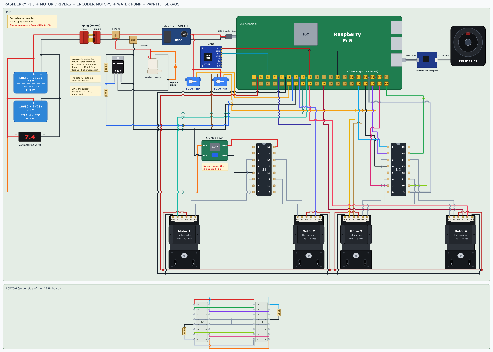

# Hardware

Wiring diagram and the 3D-printed chassis (Fusion 360 source; export an STL from it to print).

| File | What it is |
| --- | --- |
| `wiring_diagram.png` | Raspberry Pi 5, power, L293D motor drivers, encoder motors, LiDAR, IMU, water pump and pan/tilt servos |
| `Chassis.f3d` | Chassis source (Fusion 360) |

This is the Phase III wiring, with the Raspberry Pi 5 controlling everything. It has not been built or tested yet, and the Raspberry program does not drive the motors or read the encoders yet.

## Power

- **Batteries:** two 2S packs of 18650 cells in parallel (7.4 V nominal, 8.4 V full, 2000 mAh each). Charge each pack separately and join them only when their voltages are within 0.1 V.
- **T-plug:** the only power connection between the batteries and the robot. With it unplugged, nothing after it is powered, including the voltmeter.
- **Voltmeter:** connected after the T-plug, so it does not drain the batteries while the robot is off. The minimum PWM that turns the motors rises as the battery drains.
- **UBEC (7.4 V → 5 V):** feeds the Raspberry Pi through a USB-C cable **and** both SG90 servos. The servos are never connected to the 7.4 V battery line: the SG90 is rated for 4.8–6 V.
- **5 V step-down:** feeds only the logic supply of both L293D chips (pin 16). Never connect its output to the Pi's 5 V.
- **Ground:** batteries, UBEC, step-down, L293D chips, MOSFET, servos, encoders, IMU and Pi share one ground.

## Pump and servos

- **Pump:** runs from the 7.4 V line. Its negative side goes through an IRLZ44N logic-level MOSFET. The Pi drives the gate from GPIO17 (pin 11) through a 220 Ω resistor; a 10 kΩ resistor from gate to ground keeps the pump off while the Pi boots or if the wire comes loose.
- **Flyback diode:** the pump is an inductive load. A 1N5819 across it (cathode to +) protects the MOSFET from the voltage spike when it switches off.
- **Servo signals:** pan on GPIO18 (pin 12), tilt on GPIO19 (pin 35), hardware PWM.

## Motors

- **L293D board:** the diagram shows the parts side (top) and the solder side (bottom), where the matching pins of the two chips are joined so both receive the same signals. Pin 16 takes the 5 V logic supply and pin 8 takes the 7.4 V motor supply.
- **Speed:** left side on GPIO12 (pin 32) to L293D pin 1, right side on GPIO13 (pin 33) to L293D pin 9, hardware PWM. A 10 kΩ resistor from each of these lines to ground keeps the motors off while the Pi boots.
- **Direction, left side:** GPIO16 (pin 36) to L293D pin 2 and GPIO20 (pin 38) to L293D pin 7.
- **Direction, right side:** GPIO21 (pin 40) to L293D pin 15 and GPIO26 (pin 37) to L293D pin 10.
- **Motors:** motors 1 and 3 are the left pair, motors 2 and 4 the right pair. Each has a 6-pin PH2.0 plug: encoder GND, phase A, phase B, encoder VCC, Motor+ and Motor−. Motor+ and Motor− go to the L293D outputs.

## Sensors

- **Encoder power:** 3.3 V from Pi pin 1 and ground from Pi pin 9. Never use 5 V, because the GPIO pins only tolerate 3.3 V.
- **Encoder signals (A, B), with internal pull-ups:** motor 1 on GPIO22 and GPIO23, motor 2 on GPIO27 and GPIO4, motor 3 on GPIO5 and GPIO6, motor 4 on GPIO24 and GPIO25.
- **IMU (MPU6050, GY-521 module):** I2C with SDA on GPIO2 (pin 3) and SCL on GPIO3 (pin 5), 3.3 V from pin 17 and ground from pin 25. XDA, XCL, AD0 and INT stay unconnected.
- **LiDAR (RPLIDAR C1):** connects through its serial-to-USB adapter board to a USB port on the Pi. It uses no GPIO.

GPIO 7, 8, 9, 10, 11, 14 and 15 remain free.

## Things to check before trusting the wiring

- **Motor plug orientation:** confirm which side of the plug is pin 1 on the real motor before connecting it. A reversed plug could put the motor voltage on the encoder.
- **UBEC current:** the Raspberry Pi 5 can draw up to 5 A, and each servo can draw up to about 0.7 A when it stalls. Check that the UBEC rating covers both at the same time.
- **Stopping the motors:** hardware PWM keeps running if the Raspberry program freezes, so the motor code needs its own way to stop the car.
