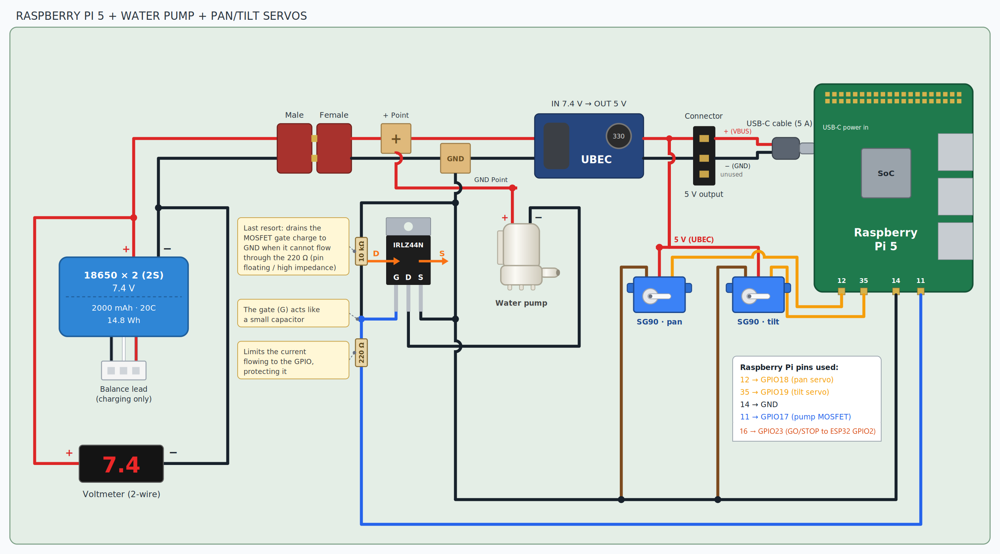
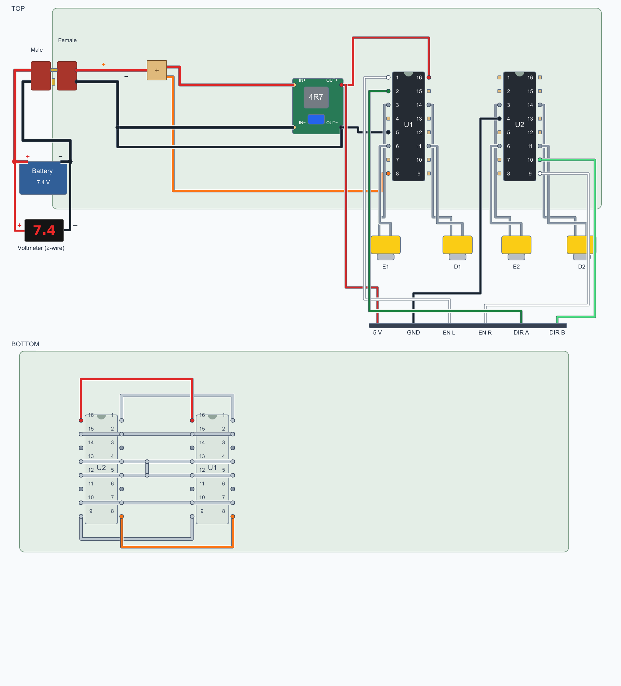

# Hardware

Wiring diagrams and the 3D-printed chassis.

| File | What it is |
| --- | --- |
| `raspberry_pump_servos.png` | Raspberry Pi 5, water pump, MOSFET and pan/tilt servos |
| `motor_drivers_l293d.png` | The two L293D motor drivers, 5 V step-down and voltmeter |
| `Chassis.stl` | Chassis ready to print |
| `Chassis.f3d` | Chassis source (Fusion 360) |

## Raspberry Pi, pump and servos

- **Battery:** 2× 18650 in series (2S, 7.4 V nominal, 8.4 V full), 2000 mAh.
- **UBEC (7.4 V → 5 V):** feeds the Raspberry Pi through USB-C **and** both SG90 servos. The servos are never connected to the 7.4 V battery line: the SG90 is rated for 4.8–6 V.
- **Pump:** runs from the 7.4 V line. Its negative side goes through an IRLZ44N logic-level MOSFET. The Pi drives the gate from GPIO17 (pin 11) through a 220 Ω resistor; a 10 kΩ resistor from gate to ground keeps the pump off while the Pi boots or if the wire comes loose.
- **Servo signals:** pan on GPIO18 (pin 12), tilt on GPIO19 (pin 35), hardware PWM.
- **GO/STOP wire:** GPIO23 (pin 16) to ESP32 GPIO2. HIGH lets the car move, LOW stops it. It is not drawn as a wire in the diagram; connect it with a shared ground between the Pi and the ESP32.
- **Ground:** battery, UBEC, MOSFET, servos, Pi (pin 14) and ESP32 share one ground.

## Motor drivers

- **Top:** the parts side. **Bottom:** the solder side, where the matching pins of the two L293D chips are joined so both chips receive the same signals.
- The 5 V step-down feeds the logic supply of both L293D chips (pin 16) and the ESP32. The motors take the battery voltage on pin 8.
- Header to the ESP32: `EN L` and `EN R` (speed of the left and right side, PWM on GPIO14 and GPIO15), `DIR A` and `DIR B` (direction, GPIO12 and GPIO13, shared by both sides), 5 V and GND.
- The voltmeter shows the battery voltage. The minimum PWM that turns the motors rises as the battery drains.

## Things to check before trusting the wiring

- **Flyback diode:** the pump is a motor, an inductive load. A diode across the pump (cathode to +) protects the MOSFET from the voltage spike when it switches off. It is not in the diagram.
- **UBEC current:** the Raspberry Pi 5 can draw up to 5 A, and each servo can draw up to about 0.7 A when it stalls. Check that the UBEC rating covers both at the same time.
- **USB-C ground:** the diagram marks the USB-C ground as unused, so the Pi's return current flows through the header ground (pin 14). Connecting the USB-C ground as well is safer.
- **GPIO2 when programming:** disconnect the GO/STOP wire before uploading to the ESP32, because GPIO2 must not be held high in download mode.
